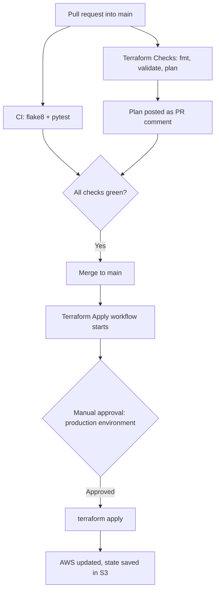

# actions-playground

A hands-on CI/CD pipeline that tests code and deploys AWS infrastructure with **GitHub Actions** and **Terraform**. It uses short-lived OIDC credentials (no stored AWS keys), remote state in S3, and a manual approval before anything is changed in AWS.

## Pipeline overview



## What it does

**On every pull request (CI)**
- `ci.yml` lints the Python code with `flake8` and runs `pytest`.
- `terraform.yml` runs `terraform fmt -check`, `init`, `validate`, and `plan`, then posts the plan as a comment on the PR so reviewers can see exactly what would change.
- PR checks use a **read-only** IAM role, so a pull request can never change AWS.

**After merge to `main` (CD)**
- `terraform-apply.yml` waits for a required reviewer to approve the `production` environment.
- After approval it runs `terraform plan -out=tfplan` and `terraform apply tfplan`, so the exact reviewed plan is applied.
- This job uses a separate **write** role, limited to the demo bucket and the state bucket, and only the `production` environment can assume it.

## What gets deployed

- An S3 bucket managed by Terraform.
- The Python files (`app.py`, `test_app.py`) uploaded to the bucket under `python/`. Terraform tracks each file's checksum, so editing a file and merging uploads the new version automatically.

## Security design

- **No long-lived credentials.** GitHub authenticates to AWS with OpenID Connect and gets temporary credentials that expire in about an hour. There are no AWS secrets stored in GitHub.
- **Least privilege.** Separate roles for plan (read-only) and apply (scoped write).
- **Trust policies** restrict each role to this repository, and the apply role to the `production` environment.
- **Remote state** in a private, versioned S3 bucket with encryption and lockfile-based state locking.
- **Human approval** gates every deployment.

## Repository structure

```
.
├── .github/workflows/
│   ├── ci.yml                # Python lint + tests on PRs
│   ├── terraform.yml         # Terraform fmt/validate/plan on PRs
│   ├── terraform-apply.yml   # Approval-gated apply after merge
│   └── hello.yml             # Starter workflow used for learning
├── app.py                    # Small Python utilities
├── test_app.py               # pytest tests
└── main.tf                   # S3 bucket, file uploads, S3 backend
```

## How to reproduce

1. Create an S3 bucket for Terraform state (private, versioning on).
2. In AWS IAM, add the GitHub OIDC identity provider (`token.actions.githubusercontent.com`).
3. Create two roles that trust the provider: a read-only plan role (trusting this repo) and an apply role (trusting the `production` environment of this repo).
4. In GitHub, create a `production` environment with a required reviewer.
5. Update the role ARNs in the workflow files and the bucket names in `main.tf`.
6. Open a pull request and watch the checks run.

Requires Terraform 1.10 or newer (for `use_lockfile` state locking).

## What I learned

- How GitHub Actions workflows, triggers, jobs, and environments fit together.
- Debugging OIDC trust policies by inspecting the real token claims.
- Why state belongs in remote storage with locking, and why plan and apply use different roles.
- Reading plan output before approving changes.

## Tech stack

GitHub Actions · Terraform · AWS (S3, IAM, OIDC) · Python · pytest · flake8
